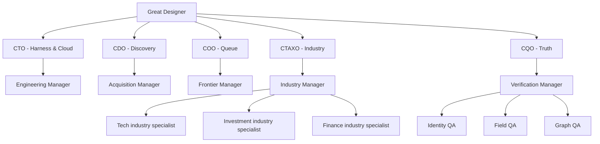

# Agent organization and cloud implementation

Every C-level owns exactly one manager. Managers provision task-specific workers on demand. `agent_control.mjs` implements real Codex SDK calls for each role, but runs **only when an external cloud service executes it with an API key**; this deliverable includes no cloud deployment receipt.

### Processing contract

1. Public web search finds LinkedIn company URLs. Similar Pages is the exclusive provenance for directed recommendation edges.
2. As soon as a card appears, append `SIMILAR_PAGES_CAPTURE` plus name, hint industry, location, actual URL if available, ordinal, parent, and evidence receipt. Missing URLs are held as unresolved candidates, never guessed.
3. Select frontier by equal P1 Tech / Investment / Finance, P2 uncertain, P3 other; every sixth dequeue give P2 a chance, every twentieth P3.
4. Fetch only with an authorized provider that supplies a page snapshot, original profile URL, structured extraction, and any completed Similar pages capture. Absence of access means WAITING_AUTHORIZED_SOURCE_PROVIDER.
5. Extract mandatory LinkedIn page URL and literal on-page industry; headline, description, followers, specialties, size, website, headquarters, year are optional and omitted when unsupported. Each field must appear in source snapshot (weak lexical check); three independent reviewer verdicts must then approve identity, fields, and graph.
6. Append immutable event and QA logs, never delete historical company rows, retry with durable backoff and leases. Count only three-QA-accepted profiles. `COMPLETE` only if count >= 1,000.
7. Great Designer can report at threshold and release checkpoint exports. Prompt updates are versioned and activated only after passing a benchmark and approved release. Handoffs require full SHA-256-checked context.

### State transitions

`PENDING_URL` -> `PENDING_PAGE` -> `LEASED` -> `PENDING_QA` -> `APPROVED` (derived) or `REVIEW` (derived). Failed fetches return to `PENDING_PAGE` after backoff. `WAITING_AUTHORIZED_SOURCE_PROVIDER` is a running state, not completion.

### Known limits

SQLite WAL on a single attached Railway volume supports **one** production writer (set replicas to one). For multiple workers, migrate to PostgreSQL SKIP LOCKED and transactional advisory locking before scaling replicas. Web search results help find URLs; they do not independently prove LinkedIn industries. The Codex SDK harness is integrated as callable role runners, not a fork of Codex or a fully automated self-modifying agent framework. `jev` source was not identified well enough for integration and was not copied.